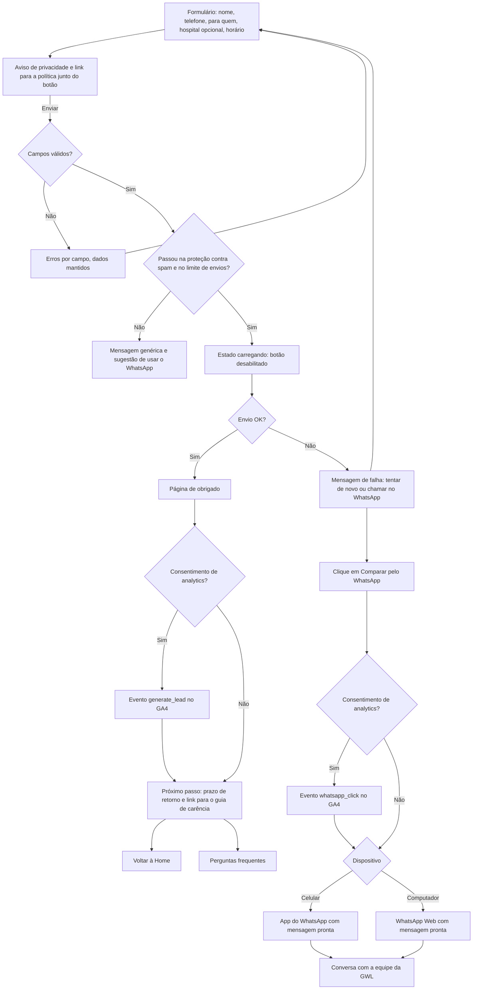

# App Flow — GWL Corretora de Seguros

> Gerado a partir do `BRIEF.md` **provisório (v0)**, em 27/10/2026, para a versão de demonstração. Pode mudar depois do briefing.
> Todo item do checklist de produção que tem página ou estado aparece aqui: 404, carregando, erro, obrigado, cookies e páginas legais.
> Harness v2.0.1 aplicado (Anexo F): CTA de cotação nunca promete contratação (R5); formulário sem dado de saúde (R12, R25); rede sempre com data (R28); faixa de "versão de demonstração" em todas as páginas (Anexo D, decisão de 27/10/2026).

## Páginas

| Rota | Página | Persona principal | Palavra-chave principal (hipótese) |
| --- | --- | --- | --- |
| `/` | Home | Todas | corretora de plano de saúde zona norte SP |
| `/planos-de-saude-60-mais` | Planos para 60+ | P1 Filha que cuida dos pais | plano de saúde para idosos zona norte |
| `/planos-de-saude-familia` | Planos para a família | P2 Família jovem | plano de saúde familiar Santana |
| `/planos-de-saude-empresas` | Planos para empresas | P3 Dono de PME | plano de saúde empresarial zona norte |
| `/planos-de-saude-mei` | MEI e autônomos | P4 MEI/autônomo | plano de saúde MEI São Paulo |
| `/trocar-de-plano` | Trocar de plano | P5 Quer trocar | portabilidade de plano de saúde |
| `/guias` | Índice de guias (hospitais e bairros) | Todas | planos de saúde por hospital zona norte |
| `/guias/hospitais/[hospital]` | Guia por hospital (modelo; 1 exemplo na demo) | P1, P2, P5 | plano de saúde que atende [hospital] |
| `/guias/bairros/[bairro]` | Guia por bairro (modelo; 1 exemplo na demo: Santana) | Todas | plano de saúde [bairro] |
| `/operadoras` | Operadoras com que trabalhamos | Todas | — (exigência R3) |
| `/perguntas-frequentes` | Perguntas frequentes | Todas | dúvidas plano de saúde carência reajuste |
| `/sobre` | Sobre a GWL | Todas | corretora de planos de saúde Santana |
| `/contato` | Contato (WhatsApp, formulário, endereço, mapa) | Todas | — |
| `/obrigado` | Obrigado (pós-formulário) | — | — (noindex) |
| `/privacidade` | Política de privacidade | — | — |
| `/termos` | Termos de uso | — | — |
| (qualquer rota inexistente) | 404 | — | — |

**Elementos globais (todas as páginas):**
- Faixa "Versão de demonstração — conteúdo em validação" no topo (só na demo; sai na versão oficial).
- Cabeçalho com menu: Para quem, Guias, Operadoras, Perguntas, Sobre e botão WhatsApp.
- Botão WhatsApp fixo no celular.
- Banner de cookies na primeira visita.
- Rodapé com identificação completa (R1), links legais, "Preferências de cookies", link para a ANS e para a consulta da SUSEP.

**Estados (não são rotas):** banner de cookies; preferências de cookies; validação de formulário com erros por campo; carregando (envio); erro de envio; abertura do WhatsApp (link externo); hospital não encontrado nos atalhos.

**Fora do fluxo nesta versão (brief v0):** simulador e tabelas de preço, contratação online, área do cliente, portal de corretores parceiros.

## Fluxo 1 — Navegação e entrada

```mermaid
flowchart TD
    E1[Google / Maps] --> ANY
    E2[Assistente de IA] --> ANY
    E3[Instagram / indicação] --> ANY
    ANY[Qualquer página de entrada] --> CK{Primeira visita?}
    CK -- Sim --> BAN[Banner de cookies]
    BAN -->|Aceitar| GA[GA4 liberado]
    BAN -->|Recusar| NOGA[Sem analytics]
    BAN -->|Preferências| PREF[Painel de preferências]
    PREF --> GA
    PREF --> NOGA
    CK -- Não --> PAG
    GA --> PAG[Página exibida com faixa de demonstração]
    NOGA --> PAG

    PAG --> HOME[Home]
    HOME -->|Card de perfil| PERF{Qual perfil?}
    PERF --> P60[Planos 60+]
    PERF --> PFAM[Família]
    PERF --> PEMP[Empresas]
    PERF --> PMEI[MEI e autônomos]
    PERF --> PTROCA[Trocar de plano]
    HOME -->|Atalho de hospital| HOSP{Existe guia do hospital?}
    HOSP -- Sim --> GH[Guia do hospital com rede datada]
    HOSP -- Não ou Outro hospital --> WA
    HOME --> GUIAS[Índice de guias]
    GUIAS --> GH
    GUIAS --> GB[Guia por bairro]
    HOME --> FAQ[Perguntas frequentes]
    HOME --> OPS[Operadoras]
    HOME --> SOBRE[Sobre]
    HOME --> CONT[Contato]

    P60 --> CTA
    PFAM --> CTA
    PEMP --> CTA
    PMEI --> CTA
    PTROCA --> CTA
    GH --> CTA
    GB --> CTA
    FAQ --> CTA
    OPS --> CTA
    SOBRE --> CTA
    CONT --> CTA
    CTA{CTA escolhido} -->|Comparar pelo WhatsApp| WA[WhatsApp com mensagem pronta do contexto]
    CTA -->|Prefiro que me liguem| FORM[Formulário curto]

    PAG -->|Rodapé| PRIV[Privacidade]
    PAG -->|Rodapé| TERM[Termos]
    PAG -->|Rodapé| PREF
    PAG -->|Rodapé| EXT[Sites externos: ANS e consulta SUSEP]
    X[URL inexistente] --> E404[404 com pergunta do hospital e volta à Home]
    E404 --> HOME
```

## Fluxo 2 — Conversão (WhatsApp e formulário)

## Regras do fluxo (harness e kit)

| Ponto do fluxo | Regra |
| --- | --- |
| Mensagem pronta do WhatsApp | Leva o contexto (perfil ou hospital), mas nunca dados de saúde. Exemplo: "Quero um plano que inclua o [hospital]". Atendimento automatizado, se houver, se identifica e passa para um corretor (R14). |
| Botões de CTA | "Comparar planos", "Falar no WhatsApp" e "Quero receber o contato". Nunca "Contratar" ou "Comprar" (R5). |
| Formulário | Campos mínimos; "para quem" é lista fechada; sem CPF, doenças, idade exata ou dados de terceiros (R12, R25). Na demo, o envio é simulado (sem banco) e a página de obrigado avisa que é demonstração. |
| Guias por hospital e bairro | Rede sempre com operadora, produto e data de referência, mais o aviso para conferir a rede atual (R28). Na demo, o exemplo usa conteúdo marcado como ilustrativo. |
| Operadoras | Lista em texto, sem logos até haver autorização (R3, R7). Na demo: "lista a confirmar". |
| Rodapé | Razão social, CNPJ, SUSEP, responsável técnico, endereço, telefone e e-mail (R1). Na demo, os campos não confirmados aparecem como "a confirmar". |
| GA4 | Só carrega depois do consentimento (R13 e regra do kit). |
| `/obrigado` | `noindex`; não fica sem saída (links para Home e FAQ). |
| Demo inteira | `noindex` e endereço provisório (Anexo D do harness). |

## Caminhos sem saída e riscos encontrados
- **WhatsApp indisponível no computador:** tratado com o WhatsApp Web. Se mesmo assim falhar, o botão secundário leva ao formulário.
- **Hospital fora da lista de atalhos:** opção "Outro hospital" abre o WhatsApp com campo livre.
- **Erro de envio do formulário:** duas saídas (tentar de novo e WhatsApp), nunca beco sem saída.
- **Bloqueio por spam:** mensagem genérica, sem revelar o motivo, com alternativa pelo WhatsApp.
- **Páginas externas (ANS, SUSEP):** abrem em nova aba para não perder o visitante.
- **Pendência:** se o portal de corretores parceiros entrar no escopo depois do briefing, ele ganha um fluxo separado, sem link no menu do consumidor.
