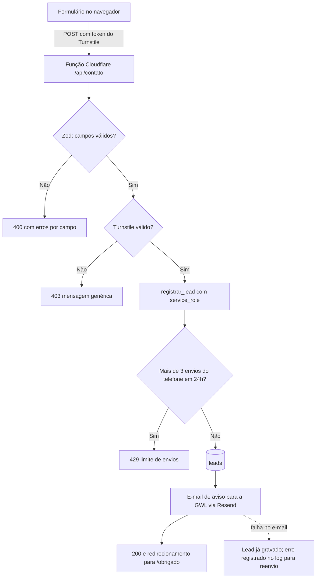
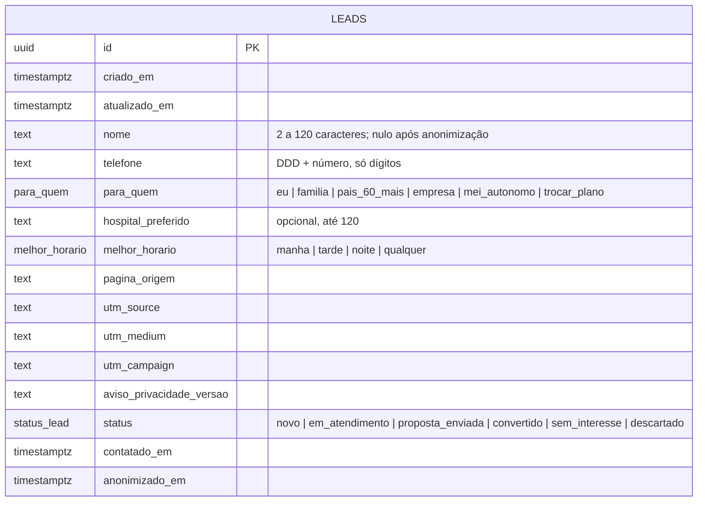

# SCHEMA.md — GWL Corretora de Seguros

> Versão 1 · 27/10/2026 · derivado do `APP_FLOW.md` e do `BRIEF.md` provisório. Arquitetura de **versão final** (decisão de 27/10/2026, Anexo D do harness): nada de modo simulado; o que muda entre prévia e produção é só a configuração `SITE_STAGE`.
> Tratar como confidencial: descreve a estrutura de dados do cliente.

## Onde o site recebe ou mostra dados (do APP_FLOW.md)

| Ponto do fluxo | Dado | Destino |
| --- | --- | --- |
| Formulário "Prefiro que me liguem" | nome, telefone, para quem, hospital preferido (opcional), melhor horário | Tabela `leads` (Supabase) + e-mail de aviso para a GWL |
| Botões do WhatsApp | nenhum dado gravado pelo site; a conversa acontece no WhatsApp da GWL | Evento `whatsapp_click` no GA4 (só com consentimento) |
| Banner de cookies | escolha do visitante | Navegador (cookie de preferência); nada no banco |
| Página de obrigado | nenhum | Evento `generate_lead` no GA4 (só com consentimento) |

Não há login, área do cliente, simulador nem contratação online (brief v0).

## Entidades

| Entidade | Campos | Regras de acesso | Integrações | Retenção (LGPD) |
| --- | --- | --- | --- | --- |
| `leads` | id, criado_em, atualizado_em, nome, telefone, para_quem (lista fechada), hospital_preferido (opcional, até 120 caracteres), melhor_horario (lista fechada), pagina_origem, utm_source/medium/campaign, aviso_privacidade_versao, status, contatado_em, anonimizado_em | RLS ligado e **sem nenhuma política** para `anon` e `authenticated`: ninguém lê, insere nem altera pela API pública. Entrada só pela função `registrar_lead()`, executável **apenas** pelo `service_role`, que fica guardado como segredo na função da Cloudflare. Leitura pela GWL no painel do Supabase (conta do cliente). | Função da Cloudflare `/api/contato` (Zod + Turnstile) → `registrar_lead()` → e-mail de aviso (Resend) para `LEAD_NOTIFY_TO` | Não convertidos: **excluídos 12 meses** após a última atualização. Convertidos: **anonimizados 24 meses** após a última atualização (fica só a métrica). Rotina diária `aplicar_retencao()` via pg_cron. |

**O que fica de fora de propósito (harness R12 e R25):** CPF, RG, e-mail, data de nascimento, idade, doenças, sintomas, medicamentos, peso, altura e qualquer dado de dependentes ou beneficiários. "Para quem" é uma categoria fechada, não identifica terceiros. O hospital preferido é texto curto e opcional. O formulário avisa para não escrever informação de saúde ali.

**Base legal (proposta, a validar com o cliente e seu jurídico):** procedimentos preliminares relacionados a contrato, a pedido do titular (LGPD, art. 7º, V). Por isso o formulário traz **aviso de privacidade** ao lado do botão, com link para a política, e não uma caixa de consentimento. A versão do aviso exibida é gravada em `aviso_privacidade_versao`. Encarregado (DPO) e canal do titular: `[A CONFIRMAR]` (exigido na política de privacidade, item 15 do checklist de produção).

## Fluxo de gravação



**Camadas contra abuso:** honeypot no formulário, Turnstile, regra de limite por IP na Cloudflare (sugestão: 5 envios a cada 10 minutos por IP), limite por telefone no banco (3 a cada 24 horas) e validação dupla (Zod na função e restrições no banco).

## Diagrama



## SQL (Supabase)

```sql
-- GWL Corretora de Seguros — esquema do banco (Supabase/Postgres)
-- Versão 1 · 27/10/2026 · ver docs/SCHEMA.md
-- Regra: nenhum acesso direto à tabela pelo navegador. O formulário chega pela
-- função da Cloudflare (/api/contato), que valida, confere o Turnstile e chama
-- public.registrar_lead() com a chave secreta (service role), guardada só na Cloudflare.

-- 1. Tipos fechados (evitam texto livre com dado sensível)
create type public.para_quem as enum (
  'eu', 'familia', 'pais_60_mais', 'empresa', 'mei_autonomo', 'trocar_plano'
);
create type public.melhor_horario as enum ('manha', 'tarde', 'noite', 'qualquer');
create type public.status_lead as enum (
  'novo', 'em_atendimento', 'proposta_enviada', 'convertido', 'sem_interesse', 'descartado'
);

-- 2. Tabela de contatos recebidos pelo site
create table public.leads (
  id                        uuid primary key default gen_random_uuid(),
  criado_em                 timestamptz not null default now(),
  atualizado_em             timestamptz not null default now(),
  nome                      text,
  telefone                  text,
  para_quem                 public.para_quem not null,
  hospital_preferido        text,
  melhor_horario            public.melhor_horario not null default 'qualquer',
  pagina_origem             text not null,
  utm_source                text,
  utm_medium                text,
  utm_campaign              text,
  aviso_privacidade_versao  text not null,
  status                    public.status_lead not null default 'novo',
  contatado_em              timestamptz,
  anonimizado_em            timestamptz,
  constraint nome_valido check (
    anonimizado_em is not null or char_length(btrim(nome)) between 2 and 120
  ),
  constraint telefone_valido check (
    anonimizado_em is not null or telefone ~ '^[1-9][0-9]{9,10}$'   -- DDD + número, só dígitos
  ),
  constraint hospital_curto check (hospital_preferido is null or char_length(hospital_preferido) <= 120),
  constraint origem_curta check (char_length(pagina_origem) <= 200),
  constraint utm_curtas check (
    coalesce(char_length(utm_source), 0) <= 100
    and coalesce(char_length(utm_medium), 0) <= 100
    and coalesce(char_length(utm_campaign), 0) <= 100
  ),
  constraint anonimizado_sem_dados check (
    anonimizado_em is null or (nome is null and telefone is null and hospital_preferido is null)
  )
);

comment on table public.leads is
  'Pedidos de contato do site. Sem dados de saúde, documentos ou dados de terceiros (harness R12/R25). Retenção: ver aplicar_retencao().';

create index leads_telefone_criado_idx on public.leads (telefone, criado_em);
create index leads_status_idx on public.leads (status, criado_em);

-- 3. Mantém atualizado_em e contatado_em
create function public.tocar_lead() returns trigger
language plpgsql set search_path = '' as $$
begin
  new.atualizado_em := now();
  if new.status <> 'novo' and old.status = 'novo' and new.contatado_em is null then
    new.contatado_em := now();
  end if;
  return new;
end $$;

create trigger leads_tocar before update on public.leads
for each row execute function public.tocar_lead();

-- 4. RLS: ligado e sem nenhuma política para anon/authenticated
--    (ninguém lê nem escreve pela API pública; o service role ignora RLS por definição)
alter table public.leads enable row level security;
alter table public.leads force row level security;
revoke all on public.leads from anon, authenticated;
-- (migração 3) política restritiva explícita: nega tudo à API pública
create policy leads_negar_api_publica on public.leads as restrictive for all to anon, authenticated using (false) with check (false);
grant select, insert, update, delete on public.leads to service_role;  -- painel e rotinas internas

-- 5. Função única de entrada, chamada só pela função da Cloudflare
create function public.registrar_lead(
  p_nome text,
  p_telefone text,
  p_para_quem public.para_quem,
  p_hospital text,
  p_melhor_horario public.melhor_horario,
  p_pagina_origem text,
  p_utm_source text,
  p_utm_medium text,
  p_utm_campaign text,
  p_aviso_versao text
) returns uuid
language plpgsql security definer set search_path = '' as $$
declare
  v_tel text := regexp_replace(coalesce(p_telefone, ''), '\D', '', 'g');
  v_id uuid;
begin
  -- normaliza +55
  if char_length(v_tel) in (12, 13) and left(v_tel, 2) = '55' then
    v_tel := substr(v_tel, 3);
  end if;

  -- limite: no máximo 3 pedidos por telefone em 24 horas
  if (select count(*) from public.leads
      where telefone = v_tel and criado_em > now() - interval '24 hours') >= 3 then
    raise exception 'limite_envios' using errcode = 'P0001';
  end if;

  insert into public.leads (
    nome, telefone, para_quem, hospital_preferido, melhor_horario,
    pagina_origem, utm_source, utm_medium, utm_campaign, aviso_privacidade_versao
  ) values (
    btrim(p_nome), v_tel, p_para_quem, nullif(btrim(p_hospital), ''), coalesce(p_melhor_horario, 'qualquer'),
    p_pagina_origem, nullif(p_utm_source, ''), nullif(p_utm_medium, ''), nullif(p_utm_campaign, ''), p_aviso_versao
  ) returning id into v_id;

  return v_id;
end $$;

revoke all on function public.registrar_lead(text, text, public.para_quem, text, public.melhor_horario, text, text, text, text, text) from public, anon, authenticated;
grant execute on function public.registrar_lead(text, text, public.para_quem, text, public.melhor_horario, text, text, text, text, text) to service_role;

-- 6. Retenção LGPD (executada diariamente pelo pg_cron)
--    a) pedidos sem conversão: excluídos 12 meses após a última atualização
--    b) convertidos: anonimizados 24 meses após a última atualização (mantém só métricas)
create function public.aplicar_retencao() returns table (excluidos int, anonimizados int)
language plpgsql security definer set search_path = '' as $$
declare
  v_exc int; v_anon int;
begin
  delete from public.leads
   where status <> 'convertido'
     and atualizado_em < now() - interval '12 months';
  get diagnostics v_exc = row_count;

  update public.leads
     set nome = null, telefone = null, hospital_preferido = null,
         utm_source = null, utm_medium = null, utm_campaign = null,
         anonimizado_em = now()
   where status = 'convertido'
     and anonimizado_em is null
     and atualizado_em < now() - interval '24 months';
  get diagnostics v_anon = row_count;

  return query select v_exc, v_anon;
end $$;

revoke all on function public.aplicar_retencao() from public, anon, authenticated;
grant execute on function public.aplicar_retencao() to service_role;

-- 7. Agendamento (rodar no Supabase, onde a extensão pg_cron existe):
-- create extension if not exists pg_cron;
-- select cron.schedule('gwl-retencao-leads', '0 6 * * *', $$select public.aplicar_retencao()$$);  -- 03:00 em Brasília
```

## Testes executados (Postgres 16, 27/10/2026)

Rodados com os papéis `anon`, `authenticated` e `service_role` simulados como no Supabase (script em `docs/schema.test.sql`).

| # | Teste | Resultado |
| --- | --- | --- |
| 1 | `service_role` registra lead com "+55 (11) 98888-7777" | OK, gravado como `11988887777` |
| 2 | `anon` lê a tabela | Bloqueado (permissão negada) |
| 3 | `anon` insere direto na tabela | Bloqueado |
| 4 | `anon` chama `registrar_lead()` | Bloqueado |
| 5 | `authenticated` lê a tabela | Bloqueado |
| 6 | Telefone inválido ("123") | Rejeitado pela restrição `telefone_valido` |
| 7 | Nome com 1 letra | Rejeitado pela restrição `nome_valido` |
| 8 | 4º envio do mesmo telefone em 24h | Rejeitado com `limite_envios` |
| 9 | Status muda de "novo" para "em_atendimento" | `contatado_em` preenchido automaticamente |
| 10 | Retenção com lead antigo não convertido (13 meses) e convertido antigo (25 meses) | 1 excluído e 1 anonimizado |

Antes de publicar: rodar o **Security Advisor** do Supabase sem alertas (item 7 do checklist de segurança) e repetir os testes 2 a 5 com as chaves reais pela API REST.

## Variáveis de ambiente (função da Cloudflare)

| Variável | Onde | Observação |
| --- | --- | --- |
| `SUPABASE_URL` | Segredo da função | — |
| `SUPABASE_SERVICE_ROLE_KEY` | Segredo da função | **Nunca** no navegador nem com prefixo `NEXT_PUBLIC_` |
| `TURNSTILE_SECRET_KEY` | Segredo da função | — |
| `NEXT_PUBLIC_TURNSTILE_SITE_KEY` | Build do site | Pública por natureza |
| `RESEND_API_KEY`, `LEAD_NOTIFY_TO` | Segredo da função | E-mail de aviso; domínio com SPF, DKIM e DMARC |
| `NEXT_PUBLIC_GA_ID` | Build do site | Carregado só após consentimento |
| `SITE_STAGE` | Build do site | `preview` (faixa de prévia, "a confirmar" visíveis, `noindex`) ou `production` |

O site **não usa** a chave `anon` do Supabase: não há nenhum acesso do navegador ao banco. `NEXT_PUBLIC_SUPABASE_ANON_KEY` fica vazia.

## Integrações
- **E-mail de aviso (Resend):** assunto "Novo pedido de contato pelo site". Corpo com nome, telefone, para quem, hospital, horário e página de origem. Sem anexos. O Resend entra na política de privacidade como operador.
- **CRM:** `[A CONFIRMAR no briefing]`. Se houver, a função envia também para o CRM depois de gravar.
- **WhatsApp:** só link com mensagem pronta; nenhum dado passa pelo site.
- **Exportação mensal:** CSV da tabela no plano de manutenção (backup, conforme `PUBLICACAO.md`).

## Cuidados
- A chave service role nunca vai ao navegador.
- O banco e as contas (Supabase, Resend, Cloudflare) são criados **em nome do cliente** antes de receber qualquer lead real. Em `preview`, o formulário só recebe envios de teste da equipe.
- Pedidos de titulares (acesso, correção, exclusão): atendidos pelo painel do Supabase; prazo e canal definidos na política de privacidade.
- Este arquivo descreve a estrutura de dados do cliente: tratar como confidencial.
